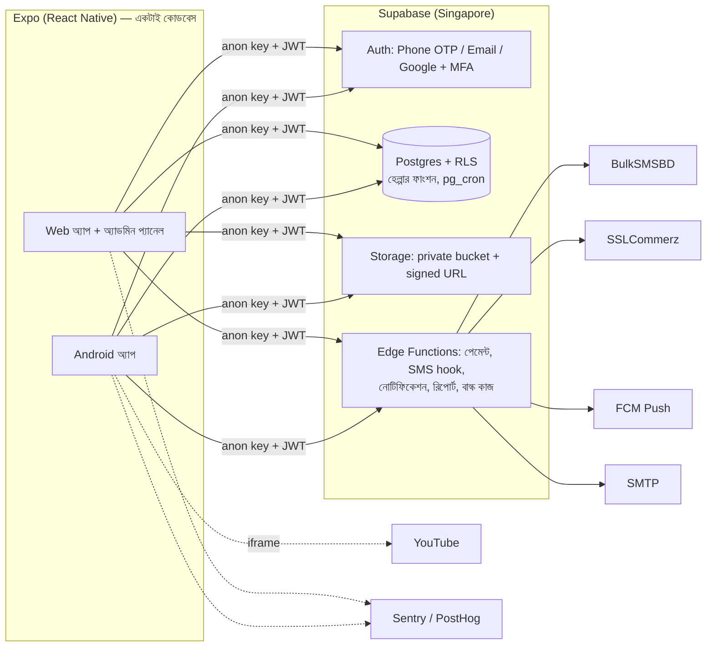

# SPARC — আর্কিটেকচার রিভিউ ব্রিফ

> **রিভিউয়ারের জন্য:** আপনার মূল্যবান সময় দেওয়ার জন্য ধন্যবাদ। এটা ২০–৩০ মিনিটে পড়ার মতো সারসংক্ষেপ। পুরো বিস্তারিত আছে [`DEVELOPMENT-GUIDE.md`](./DEVELOPMENT-GUIDE.md)-এ (প্রায় ৭০০ লাইন), দরকার হলে সেখানে দেখবেন।
>
> **আমরা যা জানতে চাই:** এই প্ল্যান নিয়ে কোড লেখা শুরু করা ঠিক হবে কিনা। কোথায় বাড়তি জটিলতা আছে, কোথায় কিছু বাদ পড়েছে, আর কোন সিদ্ধান্ত পরে বদলানো সবচেয়ে কঠিন হবে।
>
> সবচেয়ে কাজে লাগবে **§৭-এর প্রশ্নগুলোর উত্তর।**

---

## ১. প্রেক্ষাপট

**SPARC** একটা SaaS-ভিত্তিক মোবাইল লার্নিং ম্যানেজমেন্ট সিস্টেম (LMS), বাংলাদেশের জন্য।

- **ব্যবহারকারী:** স্কুল, কলেজ আর বিশ্ববিদ্যালয়ের শিক্ষার্থী; অভিভাবক; শিক্ষক ও প্রশিক্ষক; গবেষণা প্রশিক্ষণার্থী; প্রতিষ্ঠান (SaaS গ্রাহক হিসেবে)।
- **মডিউল:**
  - শেখা: কোর্স, কুইজ, হোমওয়ার্ক
  - শেখানো: শিক্ষক প্রশিক্ষণ, কোর্স নির্মাতা, আয় ভাগ
  - গবেষণা: লক করা ৪–৫ জনের গ্রুপ, ১০ ধাপের প্রজেক্ট
  - লাইব্রেরি ও স্টাডি সার্কেল
  - হিফজ (কুরআন-হাদিস মুখস্থ করা, শিক্ষককে শুনিয়ে অনুমোদন)
- **বিশেষ চাহিদা:**
  - কঠোর ডেটা বিচ্ছিন্নতা: এক স্কুল অন্য স্কুলের ডেটা কোনোভাবেই দেখবে না।
  - কে কার কার্যকলাপ দেখবে, তা ঠিক হবে সম্পর্ক দিয়ে: অভিভাবক → সন্তান, শিক্ষক → নিজের গ্রুপ।
  - শিক্ষক চাইলে পরের অধ্যায় লক রাখতে পারবেন (ফ্লিপড লার্নিং)।
  - শিক্ষাবর্ষ শেষে অটো-রোলওভার।
  - পরীক্ষায় আংশিক নকল প্রতিরোধ।
  - কে কতক্ষণ পড়ল তার ট্র্যাকিং।
- **বাস্তবতা:** কম দামি Android ফোন, দুর্বল নেটওয়ার্ক, বাংলা ও আরবি লেখা, শিশু ব্যবহারকারী, bKash/Nagad পেমেন্ট।

**টিম ও সময়:**
- ডেভেলপার: _[পূরণ করুন: কতজন, কোন অভিজ্ঞতা]_
- লক্ষ্য তারিখ (MVP / পাইলট স্কুল): _[পূরণ করুন]_
- মাসিক অবকাঠামো বাজেট: _[পূরণ করুন]_

মূল রিকোয়ারমেন্ট: [`requirements.md`](./requirements.md)

---

## ২. আর্কিটেকচার এক নজরে

**মূল ধারণা:**
- নিজস্ব কোনো ব্যাকএন্ড সার্ভার নেই। অনুমতির সব নিয়ম Postgres RLS-এ থাকবে।
- গোপন key লাগে এমন কাজ শুধু Edge Function-এ হবে।
- অ্যাপের কোডকে কখনো বিশ্বাস করা হবে না: দাম, নম্বর আর সময় সব সার্ভারে হিসাব হবে।

**স্ট্যাক:**
- অ্যাপ: Expo + Expo Router + TypeScript strict
- ডেটা ও ফর্ম: TanStack Query (persisted) + Zustand, react-hook-form + zod
- UI ও ভাষা: NativeWind, i18next (bn/en)
- বিল্ড ও আপডেট: EAS Build + EAS Update (`runtimeVersion: fingerprint`), GitHub Actions
- টেস্ট: Jest, pgTAP (RLS), Maestro, Playwright

---

## ৩. মূল ডিজাইন সিদ্ধান্ত

| # | সিদ্ধান্ত | কেন | বিবেচিত বিকল্প | আমাদের দেখা ঝুঁকি |
|---|---|---|---|---|
| 1 | **একটাই Expo কোডবেস**: Android, Web, অ্যাডমিন | ছোট টিম; লগইন, পারমিশন, ভাষা একবার লেখা | Flutter; React Native + আলাদা Next.js অ্যাডমিন | অ্যাডমিনের ডেটা-ভারী স্ক্রিন Expo Web-এ কঠিন (এখনো চূড়ান্ত নয়, §৬) |
| 2 | **Supabase (BaaS), নিজস্ব API সার্ভার নেই** | দ্রুত কাজ, Postgres, RLS, Auth আর Storage একসাথে | NestJS/Laravel + Postgres | Supabase-নির্ভরতা; Edge Function-এর সময় ও মেমরির সীমা |
| 3 | **অনুমতির নিয়ম RLS-এ**, কয়েকটা হেল্পার ফাংশনে (`has_permission`, `can_view_student`, `can_access_item`) | সার্ভার স্তরে ডেটা বিচ্ছিন্নতা নিশ্চিত হয়; অ্যাপের বাগে ডেটা ফাঁস হবে না | API স্তরে authorization | জটিল নিয়মে কুয়েরি ধীর হতে পারে; ডিবাগ কঠিন |
| 4 | **"ফিচার নয়, ইঞ্জিন"**: ৯টা সাধারণ ইঞ্জিন (পারমিশন, ফ্ল্যাগ, কনটেন্ট, অ্যাক্সেস রুল, জমা/রিভিউ, গ্রুপ, ইভেন্ট/নোটিফিকেশন, প্রোডাক্ট/পেমেন্ট, সেটিংস) | নতুন আইডিয়া এলে নতুন টেবিল বা স্ক্রিন না বানিয়ে শুধু কনফিগারেশন বদলালেই চলে | প্রতি ফিচারে আলাদা টেবিল | বাড়তি জটিলতা, অপ্রয়োজনীয় abstraction (YAGNI) |
| 5 | **content item = `type` + `config jsonb` + `config_version`**; যাচাই zod (অ্যাপে) আর `pg_jsonschema` (ডেটাবেসে) | video, pdf, quiz, book_chapter, memorization সব এক কাঠামোয় | প্রতিটা টাইপের জন্য আলাদা টেবিল | jsonb-তে রিপোর্টিং আর কুয়েরি কঠিন; স্কিমা সময়ের সাথে এলোমেলো হওয়া |
| 6 | **অ্যাক্সেস রুল ডেটা হিসেবে** (teacher release, sequential, trial, date, payment) + দ্রুত তালিকার জন্য `item_unlocks` টেবিল | ফ্লিপড লার্নিং, গাইডেড রিডিং আর হিফজ — সব একই নিয়মে | প্রতিটা মডিউলে নিজস্ব লক-লজিক | `item_unlocks` আসল নিয়মের সাথে না মেলা |
| 7 | **মাল্টি-টেন্যান্সি**: গ্লোবাল `profiles`, একজন ইউজার একাধিক প্রতিষ্ঠানে; স্বতন্ত্র ব্যবহারকারী আর মার্কেটপ্লেস কোর্সের জন্য "SPARC Platform" প্রতিষ্ঠান; বাকি টেবিলে `institution_id not null` | বহু-স্কুলের অভিভাবক, স্কুল ছাড়া ব্যবহারকারী, মার্কেটপ্লেস | আলাদা স্কিমা বা আলাদা ডেটাবেস প্রতি স্কুলে | বিভিন্ন প্রতিষ্ঠান জড়িত কেসে (মার্কেটপ্লেস কোর্স + স্কুলের শিক্ষার্থী) RLS জটিল |
| 8 | **JWT-তে শুধু membership** (কোন প্রতিষ্ঠানে কোন ভূমিকা); পারমিশন যাচাই ডেটাবেস ফাংশনে | ভূমিকা বদলালে সাথে সাথে কার্যকর; টোকেন ছোট | সব পারমিশন JWT claim-এ | প্রতিটা কুয়েরিতে বাড়তি lookup |
| 9 | **ইভেন্ট লগ** (`events`, মাসভিত্তিক partition) থেকে ট্র্যাকিং, streak, রিপোর্ট আর নোটিফিকেশন; অ্যাপ ইভেন্ট জমিয়ে ব্যাচে পাঠাবে | একটা উৎস থেকে সব রিপোর্ট; নতুন রিপোর্ট মানে নতুন কুয়েরি | প্রতি ফিচারে আলাদা ট্র্যাকিং টেবিল | টেবিলের আকার আর খরচ; ড্যাশবোর্ডের গতি |
| 10 | **টাকা**: integer পয়সা; শুধু-যোগ-করা লেজার; IPN সার্ভার থেকে পুনর্যাচাই; `tran_id` unique (idempotency); পেমেন্ট চ্যানেল প্লাগইনের মতো | হিসাবের সঠিকতা আর অডিট | — | Google Play-এর ডিজিটাল কনটেন্ট পেমেন্ট নীতি (§৫) |
| 11 | **Migration শুধু যোগ করে** (expand → migrate → contract) + `app_versions` দিয়ে force update + ফিচার ফ্ল্যাগ kill switch | OTA আপডেট পাওয়া পুরনো APK যেন না ভাঙে | — | contract ধাপে পুরনো অ্যাপ ভার্সন বন্ধ করার শৃঙ্খলা বজায় রাখা |
| 12 | **নিরাপত্তা**: পরীক্ষার উত্তর আলাদা টেবিলে, কখনো অ্যাপে যাবে না; সময় সার্ভারে; অ্যাডমিনের MFA (`aal2`); SecureStore; App Links; ছবির EXIF মোছা; শিশুর মেসেজিং শুধু অনুমোদিত সম্পর্কে | শিশু ব্যবহারকারী আর টাকা জড়িত | — | — |

---

## ৪. ফেজ প্ল্যান (সংক্ষেপে)

| ফেজ | কাজ |
|---|---|
| ০ | সেটআপ, CI, ডিজাইন সিস্টেম, ডার্ক মোড, i18n, নেটিভ মডিউল |
| ১ | ফাউন্ডেশন: টেন্যান্সি, পারমিশন, ফ্ল্যাগ, সেটিংস, ইভেন্ট, অডিট, RLS টেস্ট |
| ২ | অথ ও অনবোর্ডিং: OTP, MFA, অভিভাবক-সন্তান, শিশুর প্রোফাইল |
| ৩ | প্রতিষ্ঠান, গ্রুপ, অ্যাডমিন, বাল্ক আপলোড |
| ৪ | কনটেন্ট ও অ্যাক্সেস রুল (ফ্লিপড লার্নিং) |
| ৫ | পরীক্ষা, জমা ও রিভিউ, প্রশ্ন-উত্তর |
| ৬ | ট্র্যাকিং ও ড্যাশবোর্ড → **MVP (পাইলট স্কুল)** |
| ৭–৯ | কমার্স; নোটিফিকেশন; সার্টিফিকেট, রিপোর্ট, রোলওভার |
| ১০–১৩ | Teach, গবেষণা, লাইব্রেরি, হিফজ — **নতুন ইঞ্জিন লাগবে না**, আগের ইঞ্জিনের কনফিগারেশন |
| ১৪ | SaaS পলিশ, নিরাপত্তা অডিট, লোড টেস্ট, Play Store |

প্রতিটা ফেজে আছে প্রস্থান-শর্ত, প্রতিটা PR-এর জন্য Definition of Done (RLS টেস্ট, i18n, দুই থিম), আর প্রতিটা ফেজ শেষে Git tag।

---

## ৫. আমরা নিজেরা যে ঝুঁকি দেখছি

1. **অতিরিক্ত ইঞ্জিনিয়ারিং।** MVP আসার আগেই ৯টা ইঞ্জিন। আমাদের নিয়ম "কাঠামো আগে, ভেতর ধাপে ধাপে"। এটা কি যথেষ্ট, নাকি কিছু ইঞ্জিন (যেমন অ্যাক্সেস রুল, প্রোডাক্ট) দ্বিতীয় বাস্তব ব্যবহার না আসা পর্যন্ত পিছিয়ে দেওয়া উচিত?
2. **RLS-এর জটিলতা ও গতি।** `can_view_student()` অভিভাবক-লিংক, গ্রুপ-সদস্যতা আর কোর্স-ইনস্ট্রাক্টর তিনটা সম্পর্ক দেখে। শিক্ষকের ড্যাশবোর্ডে শত শত শিক্ষার্থীর জন্য এটা চালাতে হলে গতি কেমন হবে?
3. **Edge Function-এর সীমা।** PDF রিপোর্ট, বাল্ক আপলোড আর শিক্ষাবর্ষ রোলওভারের মতো ভারী কাজ Edge Function-এর সময় আর মেমরির সীমায় আটকে যেতে পারে। Supabase Queues (pgmq) বা আলাদা worker লাগবে কি?
4. **Offline queue।** নেট ফিরলে অ্যাপ জমানো উত্তর আর ইভেন্ট পাঠাবে। দুইবার জমা হওয়া ঠেকাতে অ্যাপে তৈরি UUID-কে idempotency key হিসেবে ব্যবহারের পরিকল্পনা আছে। পরীক্ষার উত্তর আর সার্ভারের সময়সীমার মধ্যে বিরোধ হলে কী হবে?
5. **Google Play-এর পেমেন্ট নীতি।** অ্যাপের ভেতরে ডিজিটাল কোর্স SSLCommerz দিয়ে বিক্রি করলে রিজেক্ট হতে পারে। এখনো সিদ্ধান্ত হয়নি।
6. **কনটেন্ট সুরক্ষা।** Unlisted YouTube লিংকও শেয়ার হয়ে যেতে পারে। এটা আমরা মেনে নিয়েছি।
7. **Bus factor।** ছোট টিম, আর জটিল লজিকের বড় অংশ SQL আর RLS-এ। নতুন ডেভেলপার এলে বুঝতে সময় লাগবে।
8. **Vendor lock-in।** Supabase ওপেন সোর্স Postgres, তাই দরকার হলে নিজেরা হোস্ট করার পথ খোলা আছে। তবে Auth, Storage আর Edge Function আলাদা করে সরাতে হবে।

---

## ৬. যে সিদ্ধান্তগুলো এখনো খোলা

| # | বিষয় | এখনকার ডিফল্ট |
|---|---|---|
| D3a | অ্যাডমিন প্যানেল: Expo Web নাকি Next.js (static export, monorepo) | ফেজ ৩ পর্যন্ত খোলা; `core` লজিক React Native-নির্ভর হবে না |
| D7 | Android package নাম | `college.sparc.app` |
| D8 | লঞ্চে iOS | না; শুধু Android আর Web |
| D9 | পেমেন্ট চ্যানেল | Play-এর নীতি যাচাই করে, ফেজ ৭-এর আগে |
| D10 | স্কুলের শিক্ষক কি শিক্ষার্থীর নিজে কেনা মার্কেটপ্লেস কোর্স দেখবেন | না |
| D14 | ফোন নেই এমন শিশুর অ্যাকাউন্ট | অভিভাবকের অ্যাকাউন্টের অধীনে প্রোফাইল + PIN |
| D16 | ইমেইল সার্ভিস (SMTP) | Resend / Brevo / SES |
| D17 | স্কুল বদলালে পুরনো ডেটা | পুরনো স্কুলেই থাকবে; শিক্ষার্থী নিজেরটা দেখবে |

---

## ৭. রিভিউয়ারের কাছে নির্দিষ্ট প্রশ্ন

**আর্কিটেকচার**
1. নিজস্ব API সার্ভার ছাড়া শুধু Supabase (RLS + Edge Functions) দিয়ে এই আকারের মাল্টি-টেন্যান্ট SaaS চালানো কি টেকসই? কোন অবস্থায় আলাদা ব্যাকএন্ড লাগবে বলে মনে করেন?
2. "ফিচার নয়, ইঞ্জিন" দৃষ্টিভঙ্গি কি ঠিক আছে, নাকি বাড়াবাড়ি? কোন ইঞ্জিন বাদ দেবেন, একসাথে মেলাবেন বা পিছিয়ে দেবেন?
3. content item-এর জন্য `config jsonb` + `pg_jsonschema`, নাকি প্রতিটা টাইপের জন্য আলাদা টেবিল? রিপোর্টিংয়ের কথা ভেবে কোনটা ভালো?
4. একটা কোডবেস (Expo Web) নাকি আলাদা Next.js অ্যাডমিন (D3a)?

**ডেটাবেস ও RLS**

5. টেন্যান্সি মডেল (§৩, #7) কি ঠিক আছে? মার্কেটপ্লেস কোর্স আর স্কুলের শিক্ষার্থীর মতো একাধিক প্রতিষ্ঠান জড়িত কেসে আরও ভালো কোনো প্যাটার্ন জানা আছে?
6. সম্পর্ক দিয়ে কে কার ডেটা দেখবে, তা RLS ফাংশনে হিসাব করা ভালো, নাকি একটা আগে থেকে হিসাব করা `student_viewers` টেবিল রাখা ভালো (trigger দিয়ে আপডেট হবে)?
7. ইভেন্ট টেবিলের আকার আর ড্যাশবোর্ডের গতির জন্য কী সাজেস্ট করবেন: partition, প্রতিদিনের rollup টেবিল, নাকি আলাদা analytics স্টোর?

**মোবাইল ও অপারেশন**

8. Expo + EAS Update + `fingerprint` runtime দিয়ে OTA আপডেটের কৌশল কি নিরাপদ? প্রোডাকশনে কোন ভুলগুলো দেখেছেন?
9. কম দামি Android আর দুর্বল নেটের জন্য offline-first কৌশল (persisted query + মিউটেশন queue) কি যথেষ্ট, নাকি WatermelonDB বা PowerSync-এর মতো sync ইঞ্জিন লাগবে?
10. ভারী ব্যাকগ্রাউন্ড কাজের জন্য (রিপোর্ট, রোলওভার, বাল্ক আপলোড) কী সাজেস্ট করবেন?

**প্রক্রিয়া ও স্কোপ**

11. MVP (ফেজ ০–৬) কি খুব বড়? পাইলট স্কুলে আরও আগে যেতে কী কাটবেন?
12. ফেজের ক্রম কি ঠিক আছে? পেমেন্ট (ফেজ ৭) কি MVP-তে আনা উচিত?
13. কোন সিদ্ধান্ত পরে বদলানো সবচেয়ে কঠিন হবে, যেটা এখনই আরও ভেবে নেওয়া দরকার?
14. প্ল্যানে বড় কিছু বাদ পড়েছে কি?

---

## ৮. মতামত দেওয়ার ফরম্যাট (ঐচ্ছিক)

| বিষয় / প্রশ্ন # | ✅ ঠিক আছে / ⚠️ বদলান / ❓ আলোচনা দরকার | মন্তব্য |
|---|---|---|
| | | |

---

## ৯. পূর্ণ ডকুমেন্ট
- [`DEVELOPMENT-GUIDE.md`](./DEVELOPMENT-GUIDE.md): পুরো গাইডলাইন। ডেটাবেস টেবিল তালিকা §৬, নিরাপত্তা চেকলিস্ট §৯, ফেজের প্রস্থান-শর্ত §৮।
- [`requirements.md`](./requirements.md): মূল রিকোয়ারমেন্ট
- [`decisions-log.md`](./decisions-log.md): সব সিদ্ধান্ত ও কারণ
- [`ideas-backlog.md`](./ideas-backlog.md): MVP-র বাইরের আইডিয়া
- [`risk-register.md`](./risk-register.md): ঝুঁকির তালিকা, প্রতিরোধ আর CI চেক
- গাইডলাইনের **§২০**: একই স্ট্যাকের আরেকটা SaaS প্রজেক্টের বাস্তব অভিজ্ঞতা থেকে নেওয়া টেকনিক্যাল চ্যালেঞ্জ (টেন্যান্ট ফাঁস, কিউ, concurrency, টাকা, মেসেজিং, রিলিজ)
